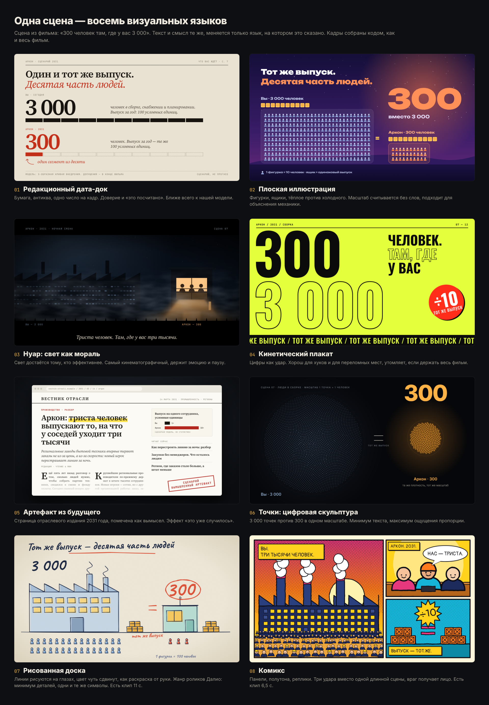

# Style packs

Two hand-drawn scenes that can be dropped into a film as `clip` scenes (studio tier, see Step 6b of the skill), and a stylebook of six more directions for reference. The film template stays the baseline; these are inserts for one or two moments. For a film that is hand-drawn throughout, use the template's own `"style": "sketch"` instead.



## The two ready packs

**`sketch.html`** is the whiteboard explainer genre (the language of Ray Dalio's "How the Economic Machine Works"): one drawing per idea, lines drawn on while the voice speaks, flat colour, no texture. Thirty figures against three, the same crates on both sides: the proportion reads without words. 11.5 seconds.

**`comic.html`** is a three-panel comic page: halftone dots, ink outlines, caption boxes, a speech bubble, a burst. Panels slam onto the page one after another. Good as a hook or a turning point, tiring over a long stretch. 6.5 seconds.

Both draw themselves from code, so there is no external asset, no network and no extra install beyond the repository's own Playwright and ffmpeg.

## Use

Look at a frame first, then render:

```
node scripts/clip.mjs examples/styles/sketch.html --still 10.5 --out work/acme/sketch.png --text '{"title":"Same output - a tenth of the people","you":"600","same":"same output","them":"60","legend":"1 figure = 20 people"}'
node scripts/clip.mjs examples/styles/sketch.html --secs 11.5 --out work/acme/clips/sketch.mp4 --text work/acme/sketch-text.json
```

Then add the scene to film.json (the path is relative to film.json):

```json
{ "type": "clip", "file": "clips/sketch.mp4", "title": "Same output, a tenth of the people", "narration": "…" }
```

Text parameters (everything else keeps its default):

| Pack | Keys | Limits |
|---|---|---|
| sketch | `title`, `you`, `same`, `them`, `legend`, `n_you`, `n_them` | title up to 38 characters; numbers up to 6; `same` up to 16; `legend` up to 30; `n_you` 1–30 figures (default 30), `n_them` 1–10 (default 3) |
| comic | `p1` (array of two caption lines), `bubble` (lines split with `\|`), `p2`, `burst`, `p3` | UPPERCASE reads best; `p1` lines up to 20 characters; bubble up to 14 per line; `p2` up to 14; `burst` up to 5; `p3` up to 20 |

Choose `n_you` and `n_them` so the picture keeps the real proportion (30 against 6 for five to one, 30 against 3 for ten to one), and make the legend say what one figure means. If a number is a model, say so in the legend (`examples/artel/clips/sketch-text.json` does). A whole film can also be hand-drawn: set `"style": "sketch"` in film.json (see `examples/artel/film.sketch.json`).

Fonts are Latin and Cyrillic only (Caveat, Neucha, Pangolin, and others under the OFL). For other scripts, use the film template instead of these packs.

## Principles behind the sketch style

Taken from how the genre is described by its makers (see `docs/video-styles-research.md`): very simple graphics with as little detail per concept as possible; every character and action looks and behaves the same way each time; the relationships are the stars, not the characters; keep numbers out of the picture where a proportion can show it; the visuals keep the details clear and the narration keeps the big picture. These packs reproduce the approach, not anyone's illustrations.

## `reference/`

Six static frames in other directions (editorial data doc, flat illustration, noir, kinetic poster, artefact from the future, dots), each a pure function of time like the packs, so `scripts/clip.mjs` can render them too. They are references for a look, with the Artel text baked in; they are not parametrized.
